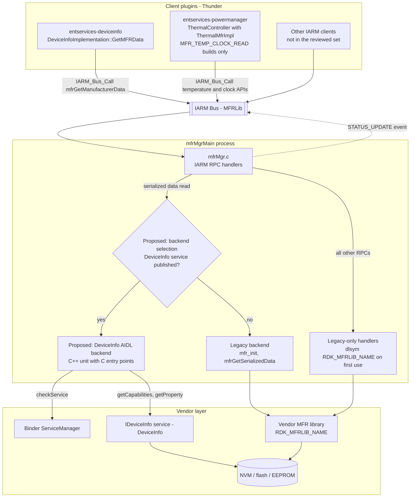
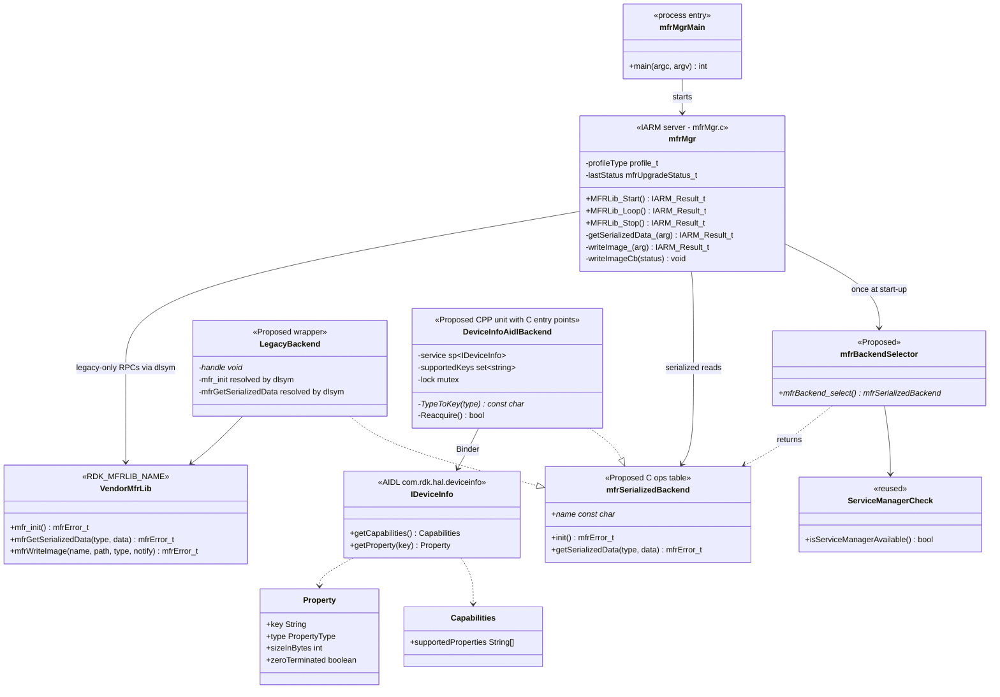
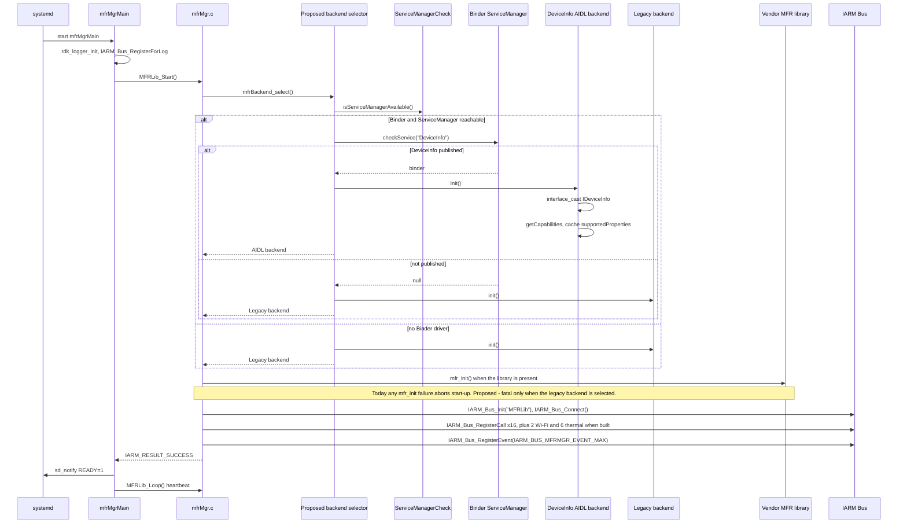
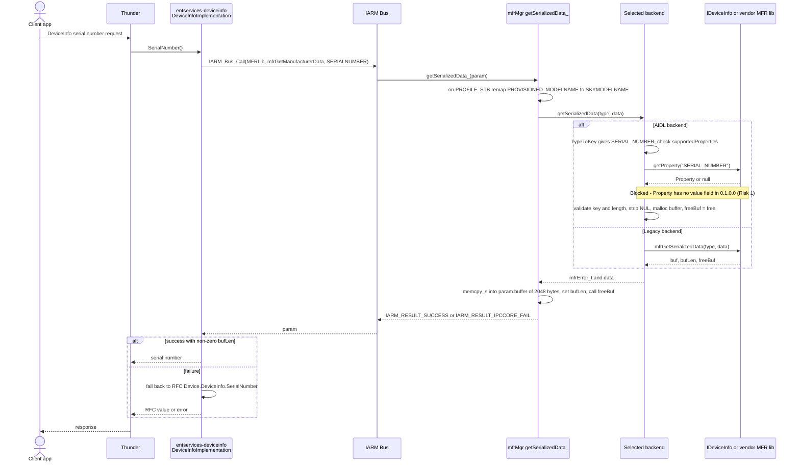
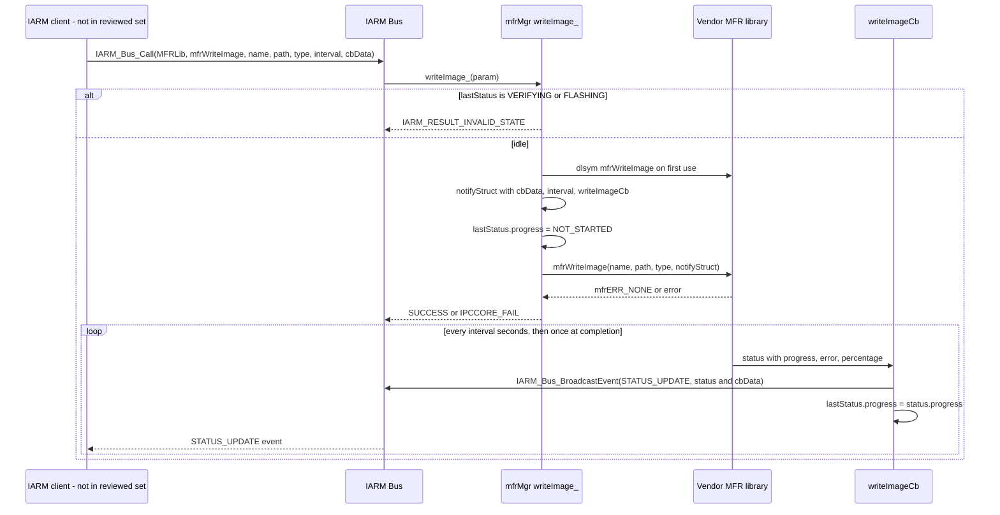
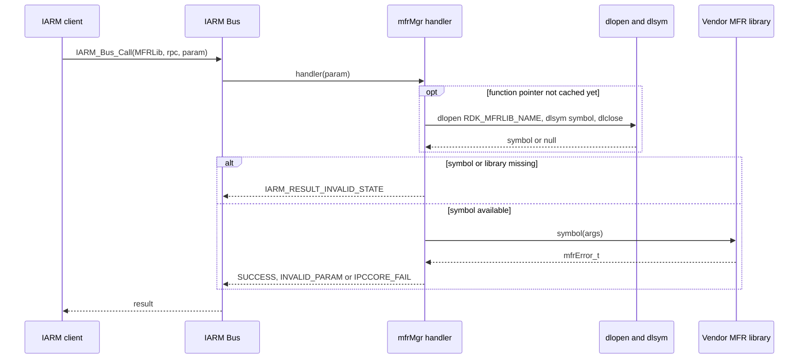
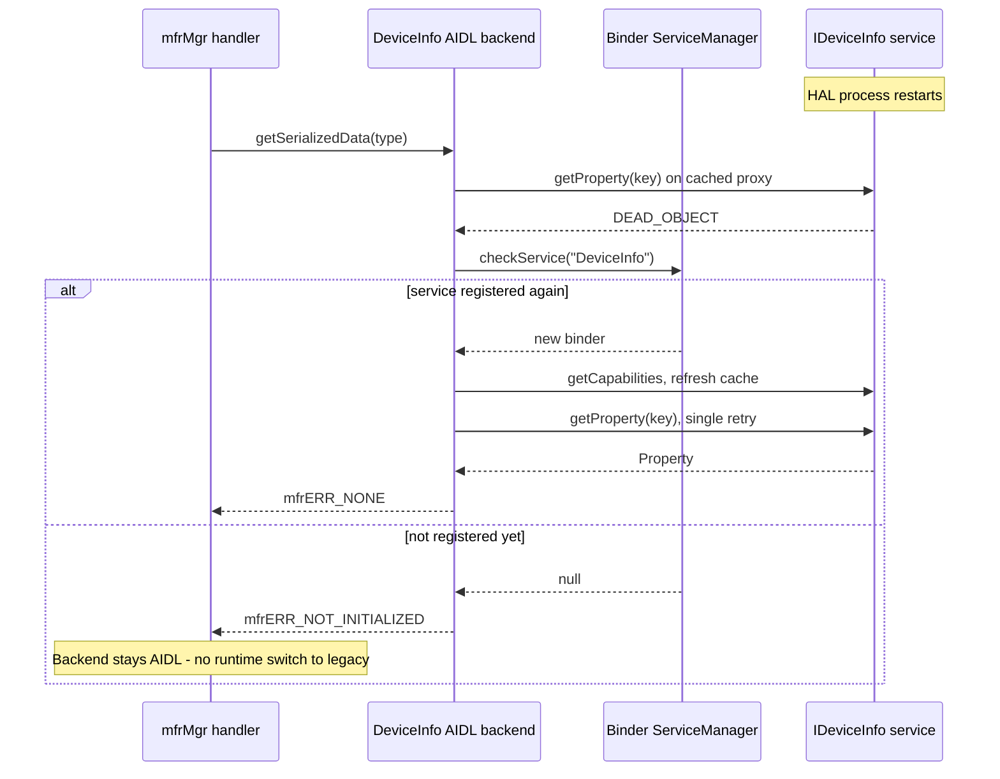

# MFR Manager — Architecture and DeviceInfo AIDL HAL Integration

| | |
| --- | --- |
| **Component** | MFR Manager — `iarmmgrs/mfr`, process `mfrMgrMain` |
| **Server type** | IARM-Bus server, bus name `MFRLib` (not a Thunder plugin) |
| **AIDL HAL** | `com.rdk.hal.deviceinfo` — `IDeviceInfo`, service name `"DeviceInfo"`, interface version `0.1.0.0` (frozen; `current` is identical) |
| **Target** | vdevice first; the design must hold for all devices and platforms |
| **Status** | Architecture and gap analysis. **Implementation not started.** Items marked *Proposed* are design targets, not existing code. |
| **Verified against** | Source snapshot under `Documentation/` (iarmmgrs, rdk-halif-aidl, entservices-deviceinfo, entservices-powermanager, entservices-devicesettings) on 22 Oct 2026 |
| **Diagrams** | Mermaid. On Confluence, render with the Mermaid macro. |

---

## 1. Purpose

MFR Manager is the RDK middleware daemon that owns access to manufacturer (MFR) data:

- **Factory-provisioned identity:** serial number, model, manufacturer, MAC addresses, hardware ID and similar data.
- **Factory and flash operations:** image write, verify and mirror; PDRI delete; bank scrub; bootloader pattern; splash screen; FSR flag; secure time; bootloader blocklist. Thermal and CPU clock operations are available on `MFR_TEMP_CLOCK_READ` builds, and Wi-Fi credentials on `ENABLE_MFR_WIFI` builds.

It runs as `mfrMgrMain`, registers RPCs on the IARM bus under `MFRLib`, and forwards every call to the vendor MFR library. Clients never call the vendor library directly through MFR Manager. They use `IARM_Bus_Call`.

### Supported backends

| Backend | Binding | Scope |
| --- | --- | --- |
| **Legacy MFR HAL** | Vendor library `RDK_MFRLIB_NAME`. `mfr_init()` and `mfrGetSerializedData()` (plus `WIFI_Get/SetCredentials` on Wi-Fi builds) are linked at build time. Every other HAL function is resolved with `dlopen`/`dlsym` on first use. | All operations |
| **AIDL HAL (DeviceInfo)** | Binder service `com.rdk.hal.deviceinfo.IDeviceInfo`, published as `"DeviceInfo"`. Read-only, stateless, and defines no listeners. | Reading persisted provisioning properties only |

### Main purpose of this document

This document defines how the **DeviceInfo AIDL HAL** is introduced into MFR Manager **without changing the IARM contract** its clients depend on. It establishes exactly which MFR operations the AIDL HAL can and cannot serve, and records the blockers and decisions that must be closed before implementation starts.

### Key findings

1. **Blocker:** In deviceinfo `0.1.0.0`, the `Property` parcelable contains only `key`, `type`, `sizeInBytes` and `zeroTerminated`. It has **no value field**, so `getProperty()` cannot return any data. The HAL documentation (`device_info.md`) says the parcelable carries the value; the AIDL does not.
2. DeviceInfo serves only the serialized-data **read** path (`mfrGetManufacturerData`). Of the 33 base `mfrSerializedType_t` values, **10 map directly**, **3 need semantic confirmation** and **20 have no key**.
3. `entservices-deviceinfo` reads 7 serialized types. **4 have no DeviceInfo key** (`PROVISIONED_MODELNAME`, `PDRIVERSION`, `HWID`, `MANUFACTURING_SERIALNUMBER`). On an AIDL-only platform, `DeviceId` and `HardwareId` would change value for devices with numeric serial numbers.
4. All write, flash, boot, time, thermal, config and Wi-Fi operations have **no DeviceInfo equivalent** and stay on the legacy HAL.
5. MFR Manager **links the vendor library at build time**, so it cannot load on a platform that ships only the AIDL HAL until those symbols become optional.

### Scope

| In scope | Out of scope |
| --- | --- |
| Serialized-data read path, backend selection, build and link changes, client impact (`entservices-deviceinfo`, `entservices-powermanager`), gaps and risks | Moving non-DeviceInfo operations onto other AIDL HALs (firmwareupdate, sensor.thermal, bootreason, indicator). These are listed in §9 for planning only. Client code changes. |

---

## 2. System Architecture

End-to-end path: client app → JSON-RPC/COM-RPC → Thunder → client plugin → `IARM_Bus_Call("MFRLib", …)` → MFR Manager handler → selected backend → vendor HAL → storage.

---

## 3. Component Responsibilities

| Component | Status | Responsibility |
| --- | --- | --- |
| `entservices-deviceinfo` — `DeviceInfoImplementation` | Existing client | Reads `SERIALNUMBER`, `MODELNAME`, `MANUFACTURER`, `PROVISIONED_MODELNAME`, `PDRIVERSION`, `HWID` and `MANUFACTURING_SERIALNUMBER` through `GetMFRData()`. Falls back to RFC or `/etc/device.properties` for some fields. |
| `entservices-powermanager` — `ThermalMfrImpl` | Existing client (`MFR_TEMP_CLOCK_READ` builds only) | Polls temperature through IARM every 30 s (`POLL_INTERVAL`), and gets or sets thermal thresholds and CPU clock through IARM. Other builds use `ThermalImpl`, which links the MFR library directly and bypasses MFR Manager. |
| IARM Bus | Existing | Transport, RPC dispatch by name, event broadcast. |
| `mfrMgrMain.c` | Existing | Process entry: logger init, `MFRLib_Start()`, `sd_notify(READY=1)`, heartbeat loop, `MFRLib_Stop()`. |
| `mfrMgr.c` | Existing | Registers 16 IARM RPCs unconditionally, plus 2 (`ENABLE_MFR_WIFI`) and 6 (`MFR_TEMP_CLOCK_READ`), and one event (`STATUS_UPDATE`). Each handler calls the vendor library. |
| Backend selector | *Proposed* | Chooses the serialized-data backend once at start-up. It is a two-entry C ops table (`init`, `getSerializedData`). No other operation has an AIDL mapping, so no wider abstraction is added. |
| Legacy backend | *Proposed* wrapper over existing calls | Calls `mfr_init` and `mfrGetSerializedData`, resolved with `dlsym` so that the vendor library becomes optional at load time. |
| DeviceInfo AIDL backend | *Proposed* | C++ translation unit with `extern "C"` entry points. Maps `mfrSerializedType_t` to a DeviceInfo key, calls `IDeviceInfo`, validates the value and returns it as `mfrSerializedData_t`. |
| `ServiceManagerCheck` | *Proposed reuse* (exists in PowerManager and DeviceSettings) | Pings the Binder context manager before `defaultServiceManager()` is used, so a platform without Binder neither blocks nor aborts. |
| `IDeviceInfo` (vendor, OEM-owned) | Existing contract | Read-only persisted properties. No listeners and no state. |
| Vendor MFR library | Existing | Legacy HAL for every operation. |

---

## 4. Public Operations

### 4.1 Operations available on both backends

Only one IARM operation can be served by both backends.

| IARM RPC (string) | Handler | Legacy mapping | AIDL mapping | Notes |
| --- | --- | --- | --- | --- |
| `mfrGetManufacturerData` (`IARM_BUS_MFRLIB_API_GetSerializedData`) | `getSerializedData_` | `mfrGetSerializedData(type, &data)` | `IDeviceInfo::getProperty(key)`, using the key mapping in §4.3. **Blocked by Risk 1.** | On `PROFILE_STB`, `PROVISIONED_MODELNAME` is remapped to `SKYMODELNAME` (8000) before the HAL call. Response buffer is 2048 bytes (`MAX_SERIALIZED_BUF`). |

### 4.2 Legacy-only operations

| IARM RPC (string) | Legacy mapping | AIDL mapping | Notes |
| --- | --- | --- | --- |
| `mfrSetManufacturerData` | `mfrSetSerializedData` (dlsym) | None. DeviceInfo is read-only (HAL.DeviceInfo.3). | Pre-existing defect: the IARM parameter is ignored and the HAL is called with no arguments (§14, #1). |
| `mfrDeletePDRI`, `scrubAllBanks` | `mfrDeletePDRI`, `mfrScrubAllBanks` | None | |
| `mfrWriteImage`, `mfrValidateImage`, `mfrMirrorImage` | `mfrWriteImage`, `mfrVerifyImage`, `mfrMirrorImage` with status callback | None in DeviceInfo. Candidate owner: `com.rdk.hal.firmwareupdate` (`updateFirmwareFromFile` with `IFirmwareUpdateListener`). Not assessed. | Asynchronous; progress is reported through the `STATUS_UPDATE` event. |
| `mfrSetBootloaderPattern` | `mfrSetBootloaderPattern` | None identified | |
| `mfrSetBlSplashScreen`, `mfrClearBlSplashScreen` | same names | None identified | |
| `mfrGetSecureTime`, `mfrSetSecureTime` | same names | None identified | Type mismatch with the HAL signature (§14, #2). |
| `mfrSetFSRflag`, `mfrGetFSRflag` | same names | None identified. `IBootReason` covers boot cause and reboot, not the FSR flag. | |
| `mfr_setConfigData`, `mfr_getConfigData` | same names | None identified | Bootloader runtime blocklist. |
| `mfrGetTemperature`, `mfrSetTempThresholds`, `mfrGetTempThresholds`, `mfrDetemineClockSpeeds`, `mfrSetClockSpeed`, `mfrGetClockSpeed` (`MFR_TEMP_CLOCK_READ`) | same names | Partial candidate: `com.rdk.hal.sensor.thermal` (`getCurrentThermalState`, `getCurrentTemperatures`). It explicitly does not expose thresholds and has no CPU clock API. | Consumed by PowerManager `ThermalMfrImpl`. |
| `mfrWifiEraseAllData`, `mfrWifiCredentials` (`ENABLE_MFR_WIFI`) | `WIFI_EraseAllData` (dlsym), `WIFI_Get/SetCredentials` (linked) | None | |
| `mfrGetPreDownloadImageSize` | — | — | Defined in `mfrMgr.h` but never registered, so calls fail at the IARM level. |

### 4.3 Serialized-data key mapping (`mfrSerializedType_t` → DeviceInfo key)

DeviceInfo keys and formats are taken from `hfp-deviceinfo.yaml` (`interfaceVersion: current`).
Legend: ✅ direct; ⚠️ candidate that needs semantic confirmation; ❌ no key.

| MFR type (value) | DeviceInfo key | HFP format / max size / zero-terminated | Status | Consumer in reviewed set |
| --- | --- | --- | --- | --- |
| `MANUFACTURER` (0) | `MANUFACTURER` | STRING / 32 / yes | ✅ | DeviceInfo `Make`, `Brand` |
| `MANUFACTUREROUI` (1) | `MANUFACTURER_OUI` | STRING / 8 / yes | ✅ The MFR header calls it a HEX string; the HFP types it STRING, not UPPERCASEHEX. | — |
| `MODELNAME` (2) | `MODEL_NAME` | STRING / 32 / yes | ✅ | DeviceInfo `Sku`, after `MODEL_NUM` in `/etc/device.properties` |
| `PRODUCTCLASS` (4) | `PRODUCT_CLASS` | STRING / 16 / yes | ✅ | — |
| `SERIALNUMBER` (5) | `SERIAL_NUMBER` | STRING / 32 / yes | ✅ | DeviceInfo `SerialNumber`, `SystemInfo`, `DeviceId` |
| `WIFIMAC` (14) | `WIFI_MAC` | MAC / 16 / no | ✅ Size conflict (Risk 3) | — (DeviceInfo reads MACs through `getDeviceDetails.sh`) |
| `BLUETOOTHMAC` (15) | `BLUETOOTH_MAC` | MAC / 16 / no | ✅ Size conflict | — |
| `WPSPIN` (16) | `WPS_PIN` | NUMERIC / 8 / yes | ✅ Size ambiguity; sensitive value | — |
| `ETHERNETMAC` (18) | `ETHERNET_MAC` | MAC / 16 / no | ✅ Size conflict | — |
| `RF4CEMAC` (20) | `RF4CE_MAC` | MAC / 16 / no | ✅ Size conflict | — |
| `COUNTRYCODE` (0x53, `PANEL_SERIALIZATION_TYPES` builds) | `COUNTRY_CODE` | ISO3166 / 2 / no | ✅ | — |
| `LANGUAGECODE` (0x54, panel builds) | `LANGUAGE_CODE` | ISO639 / 2 / no | ✅ | — |
| `DEVICEMAC` (10) | `ETHERNET_MAC`? | MAC / 16 / no | ⚠️ | — |
| `ESTBMAC` (19) | `ETHERNET_MAC`? | MAC / 16 / no | ⚠️ The MFR header says the device MAC is the same as the Ethernet MAC. | — |
| `SOC_ID` (25) | `CHIPSET_ID`? | STRING / 32 / yes | ⚠️ SoC ID and chipset ID may not mean the same thing | — |
| `PROVISIONED_MODELNAME` (21); `SKYMODELNAME` (8000) on STB | — | — | ❌ | DeviceInfo `Model` (`PLATCO`/`LLAMA` devices) |
| `PDRIVERSION` (13) | — | — | ❌ | DeviceInfo `FirmwareVersion.pdri` |
| `HWID` (23) | — | — | ❌ | DeviceInfo `DeviceId`, `HardwareId` |
| `MANUFACTURING_SERIALNUMBER` (17) | — | — | ❌ | DeviceInfo `DeviceId` fallback |
| `DESCRIPTION`, `HARDWAREVERSION`, `SOFTWAREVERSION`, `PROVISIONINGCODE`, `FIRSTUSEDATE`, `MOCAMAC`, `HDMIHDCP`, `PMI`, `MODELNUMBER`, `IMAGENAME`, `IMAGETYPE`, `BLVERSION`, `REGION`, `BDRIVERSION`, `LED_WHITE_LEVEL`, `LED_PATTERN` | — | — | ❌ (16 types). `HAL_VERSION` is the HAL interface version, not `SOFTWAREVERSION`. `COUNTRY_CODE` is not `REGION`. | — |
| Remaining panel types (0x51 onwards), `DE_SERIAL_PREFIX` | — | — | ❌ | — |

DeviceInfo keys with no MFR type: `HAL_VERSION` and `DEVICE_TYPE` (`STB`/`OTT`/`TV`). The DeviceInfo plugin derives `DeviceType` from `authService.conf` or `device.properties` and uses a different vocabulary (`IpStb`, `QamIpStb`, `IpTv`).

### 4.4 Value conversion rules (*Proposed*, AIDL backend)

| Rule | Reason |
| --- | --- |
| Map type to key with a `switch` or sparse map. Never index an array by `type`. | `type` comes from the IARM caller, and the enum is sparse (0–32, 0x51+, 8000+). |
| Reject keys that are not in the cached `getCapabilities().supportedProperties` without making a Binder call. | Avoids a transaction for keys the platform has declared unsupported. |
| `Property.key` must equal the requested key. | Contract check on the HAL response. |
| Value length must be ≤ `Property.sizeInBytes` and ≤ 2048 (`MAX_SERIALIZED_BUF`). Reject the value otherwise and never copy part of it. | Bounds safety and HFP enforcement (HAL.DeviceInfo.5). |
| Return the value bytes without a terminating NUL, with `bufLen` set to the value length. | Matches the legacy contract ("the buffer is not required to contain the null-terminator"). The client uses `assign(buffer, bufLen)`. |
| Allocate the buffer with `malloc` and set `freeBuf = free`. | The handler already calls `freeBuf` on both its success and failure paths. |
| Convert `String16` to UTF-8. Only `serviceName` is `@utf8InCpp`; `getProperty(in String)` and `Property.key` are `String16` in C++. | Generated C++ types |

---

## 5. Event Mapping

| IARM event | Trigger | Legacy source | AIDL source |
| --- | --- | --- | --- |
| `IARM_BUS_MFRMGR_EVENT_STATUS_UPDATE`, payload `{mfrUpgradeStatus_t status, cbData}` | Image write, verify or mirror progress | The vendor library calls `writeImageCb()` (registered through `mfrUpgradeStatusNotify_t`), and MFR Manager broadcasts the event. | None. DeviceInfo defines no listeners. Future candidate: `IFirmwareUpdateListener::onProgress` / `onCompleted`. |
| *(none)* — serialized data changed | — | No event | No event. DeviceInfo is synchronous and read-only. |

---

## 6. Class Diagram

MFR Manager is written in C. The diagram shows its modules as classes, and *Proposed* elements are marked.

---

## 7. Initialization and Backend Selection

**Selection rules (*Proposed*)**

- The decision is made **once per process** and never changes at runtime. This matches `HalFactoryUtility` in DeviceSettings and PowerManager.
- Use `checkService` (non-blocking). The DeviceSettings AIDL adapters use `checkService`; PowerManager's `PowerAidlImpl` uses `getService`, which blocks while it retries.
- **Ordering:** if MFR Manager starts before the DeviceInfo HAL registers, the legacy backend is selected for the life of the process. On an AIDL-only platform, MFR Manager would then be non-functional. The fix is systemd ordering (`After=` / `Wants=` on the DeviceInfo HAL unit), not polling (Risk 5).
- **No Binder thread pool is required.** DeviceInfo defines no listener callbacks, and synchronous calls run on the calling thread. Start a thread pool only if `linkToDeath` is adopted instead of re-acquiring the service lazily (§8.5).
- **Shutdown:** `MFRLib_Stop()` only disconnects from and terminates IARM. `mfr_term()` is never called, today or in the proposal (§14, #7).

---

## 8. Functional Flows

### 8.1 Serialized-data read, end to end (example: DeviceInfo serial number)

**Client impact when only the AIDL backend is present (after Risk 1 is fixed)**

| DeviceInfo API | Sources, in order | Legacy result | AIDL-only result |
| --- | --- | --- | --- |
| `SerialNumber` | `SERIALNUMBER`, then RFC | MFR value | Same (`SERIAL_NUMBER`) |
| `Sku` | `MODEL_NUM` in device.properties, then `MODELNAME`, then RFC | unchanged | Same (`MODEL_NAME`) |
| `Make` | `MANUFACTURER`, then `MFG_NAME` in device.properties | MFR value | Same |
| `Brand` | `/tmp/.manufacturer`, then `MANUFACTURER` | unchanged | Same |
| `Model` (`PLATCO`/`LLAMA` only) | `PROVISIONED_MODELNAME` (`SKYMODELNAME` on STB), then `FRIENDLY_ID` | Provisioned model | **Changes** to `FRIENDLY_ID` |
| `FirmwareVersion.pdri` | `PDRIVERSION` | PDRI version | **Empty** |
| `DeviceId` (numeric serial number) | `HWID` + `"000"` + `serial.substr(5,7)`, then `MANUFACTURING_SERIALNUMBER`, then the serial number | HWID-derived | **Changes** to the serial number |
| `HardwareId` | First 6 characters of `DeviceId` | Derived | **Changes** |

`DeviceId` is cached in memory but not persisted. The changed value therefore appears on the first boot after a backend switch, which counts as a device-identity change for any backend service keyed on it.

### 8.2 Image write or verify with status event (legacy only)

`mfrValidateImage` follows the same path through `mfrVerifyImage`. `mfrMirrorImage` also uses it, but without the busy check.

### 8.3 Legacy-only operation pattern (all other RPCs)

This pattern applies to `SetSerializedData`, `DeletePDRI`, `ScrubAllBanks`, bootloader pattern, splash screen, secure time, FSR flag, config data, and the thermal and clock RPCs. On an AIDL-only platform with no vendor library, every one of them returns `IARM_RESULT_INVALID_STATE`. For PowerManager `ThermalMfrImpl`, that means a failure on every 30-second poll.

### 8.4 PowerManager thermal polling (`MFR_TEMP_CLOCK_READ`, legacy only)

`ThermalController` polls `mfrGetTemperature` through IARM every 30 s and adjusts CPU clock and power state against fixed thresholds. Neither DeviceInfo nor `sensor.thermal` replaces this path: `sensor.thermal` exposes state and temperatures but no thresholds or clock control. Any change to MFR Manager must leave this path working (regression R3).

### 8.5 AIDL service loss and recovery (*Proposed*)

---

## 9. Backend Capability Notes

| Area | AIDL backend (DeviceInfo) | Legacy backend (vendor MFR library) |
| --- | --- | --- |
| Serialized-data read | 10 base types direct, plus 2 panel types; 3 need confirmation; 20 unsupported and return an error. **Blocked until `Property` carries a value.** | Every type the vendor library implements |
| Serialized-data write | Not supported; read-only by contract | `mfrSetSerializedData` (handler defect §14, #1) |
| Discovery | `getCapabilities().supportedProperties` declares the supported keys | None; unsupported types fail at call time |
| Format validation | `PropertyType` (MAC, NUMERIC, ISO3166, ISO639, UPPERCASEHEX, SEMANTICVERSION), `sizeInBytes`, `zeroTerminated` | None; raw bytes |
| Image write, verify, mirror and progress | None (candidate: firmwareupdate) | Supported, with `STATUS_UPDATE` |
| PDRI delete, bank scrub | None | Supported |
| Bootloader pattern, splash screen, blocklist | None | Supported |
| FSR flag, secure time | None | Supported |
| Thermal and CPU clock (`MFR_TEMP_CLOCK_READ`) | None (`sensor.thermal` is partial: no thresholds, no clock control) | Supported |
| Wi-Fi credentials (`ENABLE_MFR_WIFI`) | None | Supported |
| Events | None; no listeners | `STATUS_UPDATE` only |
| Lifecycle | Stateless; available once registered | `mfr_init()` required; `mfr_term()` never called |
| Thread safety | Binder proxies are thread-safe; the HAL holds no state | The vendor HAL is documented as not thread-safe |

---

## 10. Threading, Ownership and Timing

- **Handler blocking.** IARM RPC handlers run on the IARM server's dispatch context; this review did not verify the dispatch threading model. A backend call holds the handler for its full duration, and Binder transactions have no timeout. A hung DeviceInfo HAL therefore blocks the handler until it returns, and clients see IARM call timeouts (Risk 6).
- **Function-pointer caches.** The `static func` caches in every handler are written without locks. This is only safe if IARM dispatch is serialized, which was not verified.
- **Image-operation state.** `lastStatus` and `notifyStruct` are shared between the IARM handler and the vendor callback thread without synchronization (pre-existing, §14, #4).
- **AIDL backend locking (*Proposed*).** One mutex guards the cached `sp<IDeviceInfo>` and the supported-key set. Copy the `sp` under the lock and make the Binder call outside it, so one slow call does not serialize every read.
- **Buffer ownership.** The AIDL backend returns a `malloc`'d buffer with `freeBuf = free`. The existing handler frees it on both its success and error paths.
- **Backend decision.** Immutable for the lifetime of the process.

---

## 11. Failure and Fallback Behaviour

| Condition | Behaviour |
| --- | --- |
| Binder not reachable, or `"DeviceInfo"` not published at selection | Legacy backend for the life of the process |
| Type with no key, key not in `supportedProperties`, or HAL returns null `Property` | `mfrERR_OPERATION_NOT_SUPPORTED` → `IARM_RESULT_IPCCORE_FAIL`. This is the same IARM code legacy returns for any HAL error; clients only test for success and a non-zero `bufLen`. |
| Binder transaction fails (`DEAD_OBJECT`) | Re-acquire the service once and retry once, then return an error (§8.5) |
| Validation failure (length, key mismatch, format) | Error; nothing is copied |
| Legacy-only RPC on a platform without the vendor library | `IARM_RESULT_INVALID_STATE` (existing behaviour when a symbol is missing) |
| Mixed backends for one read | Not allowed in the baseline (strict single backend). See alternative C in §15 and Q2. |

---

## 12. Build Integration (*Proposed*)

**Current build.** `--enable-client` builds `mfr/`, producing `mfrMgrMain` from `mfrMgr.c` and `mfrMgrMain.c` (C).
- `LDFLAGS_CLIENT = -ldl ${MFR_LIB_NAME} -lsystemd`
- `CFLAGS_CLIENT = -DENABLE_SD_NOTIFY -DRDK_MFRLIB_NAME='${MFR_LIB}'`
- `mfr/common/` is an older tree that is not built.

**Proposed changes**

| Change | Detail |
| --- | --- |
| Configure switch | Add `--enable-deviceinfo-aidl` with an `AM_CONDITIONAL`. When enabled, it defines `ENABLE_DEVICEINFO_AIDL`, adds the C++ backend unit and `ServiceManagerCheck.cpp`, and builds them with `-std=c++17`. Automake switches the final link to the C++ linker automatically when a C++ source is present. |
| Libraries | Link `deviceinfo-v0.1.0.0-cpp`, `binder` and `utils`. DeviceInfo has no imports (`interface.yaml: imports: []`), so no `common` AIDL library is needed. |
| Optional vendor library | Resolve `mfr_init` and `mfrGetSerializedData` with `dlsym`, like the other optional symbols, so the binary loads on AIDL-only platforms. **Keep the `dlopen` handle open for the life of the process.** Today's `dlclose()`-then-use pattern (§14, #3) is safe only because of the link-time dependency. Removing that dependency without this change creates a use-after-unload. |
| Runtime library path | HALIF snapshot libraries are built **without RPATH** and installed under `lib/rdk-halif-aidl` by default. DeviceSettings searches the `mw/` and `vendor/` prefixes. The MFR Manager unit or image needs the library search path configured. |
| Yocto recipe | Add `DEPENDS` on rdk-halif-aidl (deviceinfo) and the Binder SDK. Add systemd ordering against the DeviceInfo HAL unit. |

---

## 13. Security Considerations

| Area | Consideration |
| --- | --- |
| Trust boundary | IARM performs no caller authentication in MFR Manager, so any process on the bus can read any serialized type, including `WPS_PIN` and `HDMIHDCP` (legacy). The AIDL path must not widen this. A per-type allow-list is recommended (Risk 10). |
| Logging | Never log property values (serial numbers, MACs, WPS PIN). The existing `mfrWifiCredentials_` logs the SSID (§14, #6). |
| Input validation | `type` is caller-controlled: look it up with a `switch`, never as an array index (§4.4). |
| Bounds | Check the value length against `Property.sizeInBytes` and 2048 before copying; keep `memcpy_s`. Compute the length from the received string; never trust `zeroTerminated` to bound a read. |
| Service identity | Confirm that only the vendor HAL can register `"DeviceInfo"` with the ServiceManager. Otherwise any process could serve device identity data (Q9). |

---

## 14. Pre-existing Observations (not introduced by this design; recorded for triage)

| # | Observation | Location | Impact |
| --- | --- | --- | --- |
| 1 | `setSerializedData_` casts `mfrSetSerializedData` to a zero-argument function and calls it with no arguments, ignoring the IARM parameter. The HAL signature is `mfrSetSerializedData(mfrSerializedType_t, mfrSerializedData_t*)`. | `mfrMgr.c` | Undefined behaviour; the vendor code reads garbage arguments |
| 2 | `get/setSecureTime_` pass `unsigned long*` (`IARM_Bus_MFRLib_SecureTime_Param`) to a HAL that takes `uint32_t*`. | `mfrMgr.c` | On LP64 targets the upper 32 bits are not written by the HAL |
| 3 | Every optional symbol is resolved with `dlopen`, `dlsym`, then `dlclose`, and the pointer is used afterwards. | `mfrMgr.c` | Safe only while the link-time dependency keeps the library loaded |
| 4 | `lastStatus` and `notifyStruct` are shared across threads without locking, and `mirrorImage` has no busy check. | `mfrMgr.c` | Race on concurrent image operations |
| 5 | `IARM_BUS_MFRLIB_API_GetPreDownloadSize` is defined but never registered. | `mfrMgr.h` | Callers get an IARM failure |
| 6 | `mfrWifiCredentials_` logs the SSID. | `mfrMgr.c` | PII in logs |
| 7 | `MFRLib_Stop()` never calls `mfr_term()`. | `mfrMgr.c` | Vendor resources are not released |
| 8 | Client: `DeviceId` calls `serialNumber.substr(5,7)` when HWID is present, which throws `std::out_of_range` for a numeric serial shorter than 5 characters. | `entservices-deviceinfo` | Plugin crash on malformed provisioning data |

---

## 15. Design Alternatives Considered

| Option | Description | Pros | Cons |
| --- | --- | --- | --- |
| **A (baseline)** | AIDL backend inside MFR Manager; IARM contract unchanged | Clients untouched; one owner of the key mapping; same selection pattern as DeviceSettings and PowerManager | Keeps the IARM hop; needs a C/C++ bridge in a C daemon; MFR Manager is still required for non-DeviceInfo operations |
| B | `entservices-deviceinfo` calls `IDeviceInfo` directly for reads | Removes the IARM hop for the main consumer; the plugin is already C++, and DeviceSettings sets a Binder precedent | Key mapping duplicated per client; two read paths for the same data; PowerManager and other IARM clients still need MFR Manager |
| C | Hybrid per type: AIDL for mapped types, legacy for unmapped types when the vendor library is present | Preserves `DeviceId`/`HWID` on transitional platforms | Device identity comes from two storage paths; harder to test; departs from the one-backend-per-component pattern; gives nothing on AIDL-only platforms |

---

## 16. Open Questions and Decisions Required

| # | Question | Proposed baseline |
| --- | --- | --- |
| Q1 | Integration point: option A or option B? | A |
| Q2 | Strict single backend, or hybrid (option C)? | Strict |
| Q3 | Source for `PROVISIONED_MODELNAME`, `PDRIVERSION`, `HWID` and `MANUFACTURING_SERIALNUMBER` under AIDL: extend the HFP with OEM keys, or accept the identity change? | Extend the HFP before switching any deployed device |
| Q4 | STB remap `PROVISIONED_MODELNAME` → `SKYMODELNAME` under AIDL | Needs an operator-specific key; return an error until it is defined |
| Q5 | Confirm `DEVICEMAC`/`ESTBMAC` → `ETHERNET_MAC` and `SOC_ID` → `CHIPSET_ID` | Confirm with the vendor layer team |
| Q6 | Start-up ordering against the DeviceInfo HAL | systemd `After=` and `Wants=`; no polling |
| Q7 | Which AIDL HAL owns the non-DeviceInfo MFR operations on AIDL-only platforms? | Separate workstreams (firmwareupdate, sensor.thermal, bootreason, indicator) |
| Q8 | Does vdevice ship a DeviceInfo AIDL service? None was found in the reviewed workspace. | Confirm |
| Q9 | Can the ServiceManager restrict which process registers `"DeviceInfo"`? | Confirm |

---

## 17. Proposed Test Scenarios

Types: **S** simulation, **N** negative, **E** edge, **R** regression, **Sec** security, **St** stress.

| ID | Type | Scenario | Expected result |
| --- | --- | --- | --- |
| S1 | S | DeviceInfo published before MFR Manager starts; read `SERIALNUMBER` | AIDL backend logged; value equals the HFP value; `bufLen` equals the value length (no NUL) |
| S2 | S | Platform without `/dev/binder` | Legacy backend; no abort or hang; start-up time unchanged |
| S3 | S | MFR Manager starts first, then the DeviceInfo HAL | Behaviour matches the Q6 decision, deterministically |
| S4 | S | Kill the DeviceInfo service during a read loop (1 read/s) | At most one failed read, then recovery (§8.5) |
| S5 | S | DeviceInfo HAL blocks `getProperty` for 30 s | Client IARM call times out; MFR Manager serves calls again once the HAL returns; no crash |
| N1 | N | Read an unmapped type (`HWID`) on the AIDL backend | `IARM_RESULT_IPCCORE_FAIL`; no Binder transaction (check HAL logs) |
| N2 | N | Key missing from `supportedProperties` | Failure without a `getProperty` call |
| N3 | N | HAL returns a null `Property` | Failure; `bufLen` stays 0 |
| N4 | N | Out-of-range types through IARM: −1, 33 (`MAX`), 0x50, 9999 | Failure; no crash |
| N5 | N | AIDL-only platform: call `WriteImage`, `GetFsrFlag`, `GetTemperature` | `IARM_RESULT_INVALID_STATE`; MFR Manager stays up |
| E1 | E | Value length equal to `sizeInBytes`, then `sizeInBytes` + 1 | Accepted, then rejected |
| E2 | E | 17-character MAC with `sizeInBytes` 16 | Behaviour per the Risk 3 resolution |
| E3 | E | ISO3166 value of exactly 2 bytes, `zeroTerminated = false` | `bufLen` 2, no NUL |
| E4 | E | Value longer than 2048 bytes | Rejected; no overflow (ASan clean) |
| E5 | E | Legacy: numeric serial shorter than 5 digits with HWID present | DeviceInfo plugin must not crash (exposes §14, #8) |
| R1 | R | `DeviceId`/`HardwareId` before and after switching backends on the same device | Identical. **Fails today** (Risk 2). |
| R2 | R | Image write progress events on legacy | Interval and final status unchanged |
| R3 | R | PowerManager thermal polling on legacy (`MFR_TEMP_CLOCK_READ`) | Unchanged |
| Sec1 | Sec | Search MFR Manager logs for serial, MAC and WPS PIN values after S1 | No values found |
| Sec2 | Sec | A non-vendor process registers `"DeviceInfo"` before the HAL | Registration refused (depends on Q9) |
| St1 | St | 5 clients × 1000 mixed-type reads | Consistent values; no leaks (`freeBuf` on every path) |

---

## 18. Risks 

| # | Risk | Resolution | Ticket/Issue link |
| --- | --- | --- | --- |
| 1 | DeviceInfo `Property` has no value field in both frozen `0.1.0.0` and `current`, so `getProperty()` cannot return data. The HAL documentation says it does, and the metadata shows all four reviewer groups as `reviewed`. | Add a value field to `Property` in a new interface version and align the documentation. | TBD — raise on rdk-halif-aidl |
| 2 | 20 of 33 serialized types have no key. 4 of the 7 types `entservices-deviceinfo` reads are not covered, so `DeviceId` and `HardwareId` change on AIDL-only platforms. | Add OEM keys to the DeviceInfo HFP, or formally approve the identity change before rollout. | TBD |
| 3 | HFP size conflicts: MAC values are 17 characters but `max_size` is 16. `WPS_PIN` is 8 digits with `zero_terminated: true` and `max_size` 8. Whether `sizeInBytes` includes the NUL is undefined. | Define `sizeInBytes` semantics and correct the HFP. | TBD |
| 4 | MFR Manager links `mfr_init`, `mfrGetSerializedData` and the Wi-Fi APIs at build time, so it cannot load without the vendor library. | Resolve them with `dlsym` and keep the handle open (§12). | — |
| 5 | The backend decision is cached once, so a DeviceInfo HAL that registers after MFR Manager starts leaves it on legacy permanently. | systemd ordering on the HAL unit. | — |
| 6 | A blocking Binder call holds the IARM handler, and Binder transactions have no timeout. | Keep HAL calls short; never call Binder under a handler-wide lock; monitor IARM latency. | — |
| 7 | Non-DeviceInfo MFR operations have no AIDL owner. On AIDL-only platforms they fail, including PowerManager thermal polling. | Plan a migration per operation (firmwareupdate, sensor.thermal, bootreason, indicator). | — |
| 8 | No DeviceInfo AIDL service implementation for vdevice was found in the reviewed workspace. | Confirm vendor-layer delivery and the vdevice HFP. | — |
| 9 | Pre-existing `setSerializedData_` signature mismatch (undefined behaviour). | Fix independently of the AIDL work. | — |
| 10 | Any IARM client can read sensitive types (`WPS_PIN`, `HDMIHDCP`). | Security review and per-type allow-list. | — |

---

